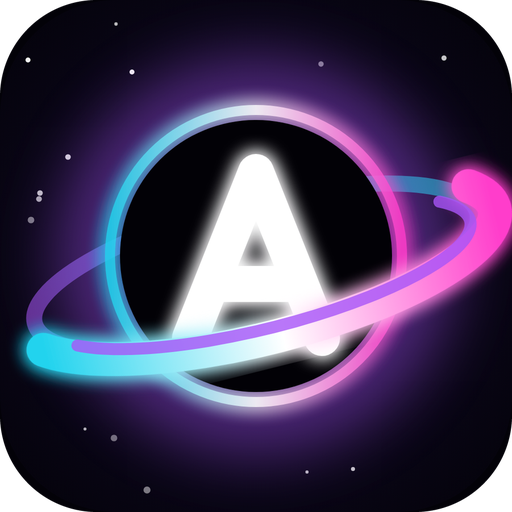
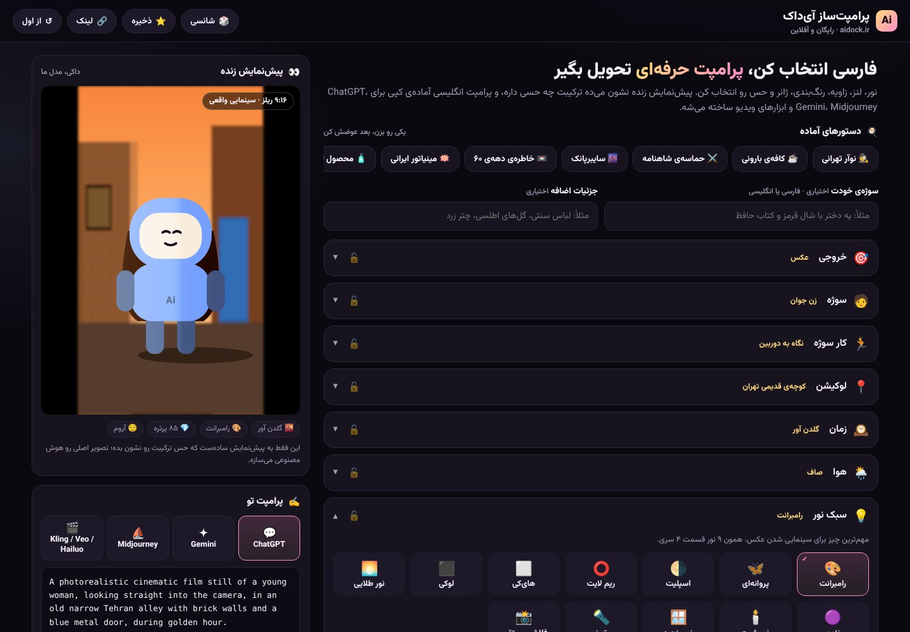
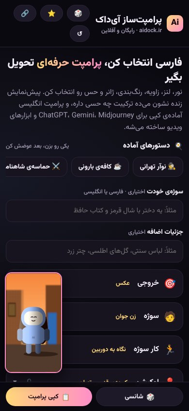

# پرامپت‌ساز آی‌داک · AiDock Prompt Builder

**فارسی انتخاب کن، پرامپت انگلیسی حرفه‌ای تحویل بگیر.**
رایگان · بدون ثبت‌نام · آفلاین · بدون API

[🌐 aidock.ir](https://aidock.ir) · [▶️ YouTube](https://youtube.com/@aidock_ir) · [📷 Instagram](https://instagram.com/aidock.ir)

---

## این چیه؟

یه ابزار تک‌فایلیه که با چند کلیک فارسی، یه پرامپت انگلیسی سینمایی برای ChatGPT، Gemini، Midjourney و ابزارهای ویدیو مثل Kling و Veo می‌سازه.
فرق یه عکس معمولی با یه عکس سینمایی، چند تا تصمیمه: نور، لنز، زاویه، رنگ‌بندی، سبک و حس. این ابزار همه‌شون رو با دکمه‌های فارسی ازت می‌پرسه.

## امکانات

- **۲۱ بخش و ۱۸۹ گزینه:** خروجی، سوژه، کار سوژه، لوکیشن، زمان، هوا، سبک نور، جهت نور، رنگ نور، کادر، لنز، زاویه، حرکت دوربین، رنگ‌بندی، سبک تصویر، ژانر، حس و حال، افکت‌ها، جزئیات، «نمی‌خوام» و نسبت تصویر
- **داکی، پیش‌نمایش زنده:** هر انتخابی بکنی همون لحظه روی داکی دیده می‌شه، از نور و سایه تا بارون و سبک تصویر
- **خودم، از عکسم:** پرامپت به هوش مصنوعی می‌گه صورتِ عکسِ ضمیمه‌شده‌ت رو عوض نکنه
- **۱۰ دستور آماده:** نوآر تهرانی، کافه‌ی بارونی، حماسه‌ی شاهنامه، مینیاتور ایرانی، سایبرپانک و…
- **مقصد پرامپت:** ChatGPT، Gemini، Midjourney یا ابزارهای ویدیو، با حرکت دوربین و زمان‌بندی
- **شانسی و قفل:** ترکیب شانسی بساز و چیزی که دوست داری رو قفل کن
- **ذخیره و لینک:** ترکیب‌هات رو ذخیره کن یا لینکش رو بفرست
- **این پرامپت چی می‌گه؟** معنی فارسیِ هر تیکه از پرامپت انگلیسی
- موبایل‌فرندلی، با پیش‌نمایش شناور

## استفاده

فقط فایل `index.html` رو دانلود کن و توی مرورگر باز کن. هیچ نصب، API یا اینترنتی لازم نیست.

## ساختار پروژه

| مسیر | توضیح |
|---|---|
| `index.html` | نسخه‌ی نهایی و تک‌فایلی ابزار |
| `src/src.html` | کد رابط کاربری و پیش‌نمایش داکی |
| `src/data.js` | همه‌ی بخش‌ها و گزینه‌ها: برچسب فارسی، عبارت انگلیسی و تنظیمات پیش‌نمایش |
| `build.py` | `python3 build.py` دیتا و فونت رو داخل `index.html` می‌ذاره |

برای اضافه‌کردن گزینه‌ی جدید، `src/data.js` رو ویرایش کن و `build.py` رو اجرا کن.

## ابزارهای رایگان دیگه‌ی آی‌داک

- 💬 [چت‌ساز آی‌داک](https://github.com/aidock-ir-dev/aidock-chat-maker)
- 🎨 [رنگ‌یاب آی‌داک](https://github.com/aidock-ir-dev/aidock-palette)
- 📱 [ماکاپ‌ساز آی‌داک](https://github.com/aidock-ir-dev/aidock-mockup)

کلی پرامپت فارسیِ تست‌شده هم روی **[aidock.ir](https://aidock.ir)** منتظرته.

---

**English:** A free, offline, single-file prompt builder. Pick options in Persian and get a cinematic English prompt for ChatGPT, Gemini, Midjourney or video tools, with a live mascot preview of every choice. Open `index.html` in any browser — no install, no API.

Font: [Vazirmatn](https://github.com/rastikerdar/vazirmatn), SIL Open Font License, see `fonts/OFL.txt`.
Code: MIT License.
